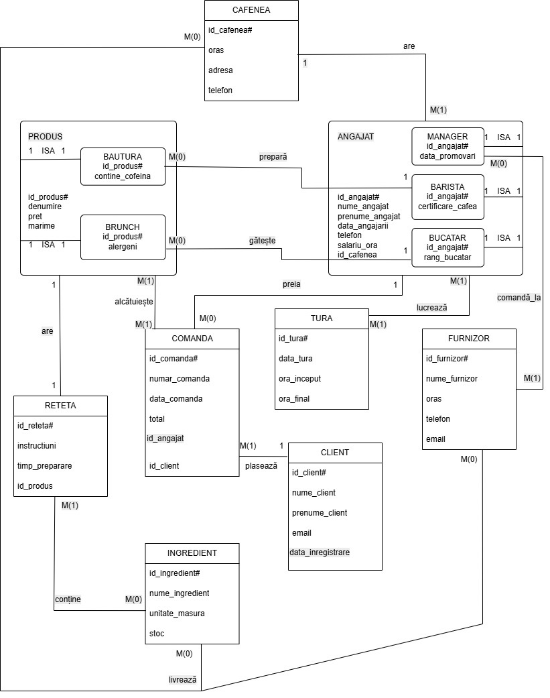
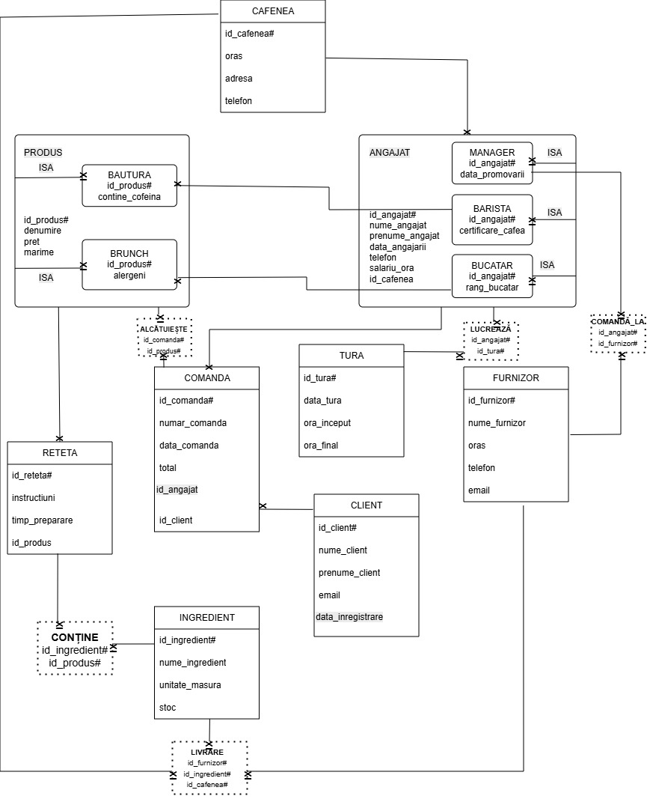

# Coffee Chain Management Database

**Oracle SQL · Relational Data Modeling · Advanced Queries · Query Optimization**

A university database project modeling the operations of a multi-branch coffee shop franchise. The relational model covers branch operations, staff roles and shifts, products and recipes, customer orders, inventory, suppliers, and deliveries.

> **Scope:** Database implementation and analytical SQL, not a deployed web application. SQL was extracted from the original coursework and organized by purpose; execution has **not** been independently verified against a live Oracle instance.

## Highlights

- **19 relational tables** with primary/foreign keys, uniqueness, checks, and defaults.
- Employee and product subtype modeling; associative tables for many-to-many and ternary relationships.
- **5 advanced reporting queries** plus outer-join, relational-division, and top-N examples.
- Oracle SQL techniques: CTEs (`WITH`), correlated subqueries, `GROUP BY` / `HAVING`, `CASE`, `DECODE`, `NVL`, string and date functions.
- Normalization analysis through 3NF with BCNF/4NF/5NF and denormalization discussion.
- Relational algebra query rewrites to illustrate selection pushdown and explicit joins (no measured performance claims).

## Schema diagrams

**Entity-relationship diagram**



**Relational schema**



## Repository structure

```text
coffee-chain-management-database/
├── README.md
├── sql/
│   ├── 01_sequences.sql
│   ├── 02_schema.sql
│   ├── 03_seed_data.sql
│   ├── 04_advanced_queries.sql
│   ├── 05_reporting_view.sql
│   ├── 06_query_optimization.sql
│   ├── 07_dml_experiments.sql
│   └── 08_view_dml_experiments.sql
├── diagrams/
│   ├── entity_relationship_diagram.jpeg
│   └── relational_schema.jpeg
└── docs/
    └── original_project_documentation.docx
```

## Getting started

**Prerequisites:** Oracle Database and a compatible SQL client, such as Oracle SQL Developer or SQLcl.

Run **in order** on a fresh schema:

1. `sql/01_sequences.sql` — create 9 identifier sequences.
2. `sql/02_schema.sql` — create 19 related tables with integrity constraints.
3. `sql/03_seed_data.sql` — insert the sample records and commit.
4. `sql/05_reporting_view.sql` — create the order reporting view.
5. `sql/04_advanced_queries.sql` — explore business reports.
6. `sql/06_query_optimization.sql` — compare equivalent query formulations.

**Important:** The seed data depends on generated identifiers and assumes the initial sequence values in an empty schema. Run the setup once in that order; rerunning the inserts may violate uniqueness constraints. Oracle-specific syntax is not portable to SQLite or PostgreSQL without adaptation.

The remaining scripts, `07_dml_experiments.sql` and `08_view_dml_experiments.sql`, are **coursework demonstrations, not setup scripts**. They include changes to data and an intentionally invalid modification through a view. Review individual statements before executing; do not run them as part of a normal setup.

## Example analytical questions

| Business question | SQL techniques |
| --- | --- |
| Which products and locations does each customer prefer? | CTEs, aggregation, nested subqueries |
| Which branches outperform average branch sales? | Joins, grouped aggregates, subqueries |
| How should products be grouped by recipe complexity? | Conditional expressions, aggregation |
| What is the procurement activity by manager? | Joins, nested queries, aggregation |
| Which rows satisfy a multi-table filtering query? | Relational algebra, selection pushdown, joins |

See [`sql/04_advanced_queries.sql`](sql/04_advanced_queries.sql) and [`sql/06_query_optimization.sql`](sql/06_query_optimization.sql) for the actual SQL.

## Design notes and limitations

- This is a **coursework database model** built for Oracle SQL, with original Romanian sample data and some Romanian SQL aliases/comments.
- The SQL was **transcribed/extracted from project documentation**, preserving original behavior rather than silently refactoring it. Some conceptual business requirements are described in the documentation but not necessarily enforced by database constraints.
- The database has **not been run through automated integration tests** in this repository; an Oracle environment is needed to confirm execution and any data/constraint issues.
- The optimization exercise compares algebraic formulations and SQL structure, **not execution plans or benchmark measurements**.
- The supplied `CONTINE` table links products to ingredients in its implemented SQL, while parts of the conceptual write-up describe a recipe-to-ingredient relationship. This mismatch is preserved for transparency and could be addressed in a later revision.

## Academic context

Individual database coursework project, Faculty of Mathematics and Computer Science, **University of Bucharest**, June 2026.

**Author:** Eliza-Georgiana Boroș
